# Arsitektur & Rencana Implementasi: ULT Queue FKIP Unila

Aplikasi antrean pelayanan administrasi berbasis Android (**ULT Queue FKIP**) untuk Unit Layanan Terpadu (ULT) Fakultas Keguruan dan Ilmu Pendidikan, Universitas Lampung.

---

## 1. Ringkasan Kebutuhan & Hasil Kesepakatan (Grill-Me)

Berdasarkan wawancara keselarasan teknis yang telah disepakati:
1. **Identifikasi Mahasiswa**: Tanpa akun login/password rumit. Mahasiswa menginput **Nama Lengkap**, **NPM**, dan **Program Studi** FKIP Unila saat mengambil tiket. Disimpan pada `SharedPreferences` perangkat dan dibatasi **1 tiket aktif per hari per NPM**.
2. **Format Penomoran & Loket**:
   - Kode Prefix per Layanan:
     - **A-xxx**: Pengurusan Berkas KKN (contoh: `A-001`)
     - **B-xxx**: Pengajuan Berkas Wisuda (contoh: `B-001`)
     - **C-xxx**: Pengurusan Surat Administrasi (contoh: `C-001`)
     - **D-xxx**: Layanan Administrasi Lainnya (contoh: `D-001`)
   - Reset urutan otomatis setiap hari (`queue_date = CURRENT_DATE`).
   - Petugas memanggil antrean ke **Loket Terpilih** (Loket 1, Loket 2, Loket 3).
3. **Siklus Status Antrean (4 Tahap + No-Show)**:
   - `waiting`: Menunggu panggilan di ruang tunggu.
   - `called`: Dipanggil menuju Loket tertentu.
   - `in_service`: Berkas sedang diproses oleh petugas di loket.
   - `completed`: Pelayanan selesai.
   - `skipped`: Mahasiswa tidak hadir setelah dipanggil berkali-kali.
4. **Keamanan RLS & Notifikasi**:
   - RLS ketat: Mahasiswa (`anon`) hanya diizinkan `INSERT` & `SELECT`. Modifikasi status (`UPDATE`) hanya dapat dilakukan oleh akun petugas (`authenticated` dengan role `staff`).
   - Notifikasi Realtime: Listener `postgres_changes` Supabase memicu dialog visual mencolok, getar haptic, dan suara panggilan otomatis via **TTS (Text-to-Speech)** lokal di HP mahasiswa.
5. **Batasan Operasional & Kuota**:
   - Jam Operasional ULT: **Senin – Jumat, 08:00 – 15:00 WIB**.
   - Kuota harian maksimal per jenis layanan (misal: 50 antrean/layanan/hari).

---

## 2. Alur Storyboard & Diagram Sistem

```mermaid
flowchart TD
    subgraph Mahasiswa ["Alur Mahasiswa (Tanpa Login)"]
        M1["Splash Screen"] --> M2["Beranda ULT FKIP"]
        M2 --> M3{"Cek Jam Operasional"}
        M3 -- "Tutup / Libur" --> M4["Tampilkan Banner Tutup"]
        M3 -- "Buka (08:00 - 15:00 WIB)" --> M5["Pilih Layanan & Form Data Diri (Nama, NPM, Prodi)"]
        M5 --> M6{"Validasi: Kuota & Tiket Aktif?"}
        M6 -- "Sudah Ada Tiket Aktif" --> M7["Buka Tiket Aktif Berjalan"]
        M6 -- "Valid" --> M8["Generate Nomor Tiket (Atomic RPC)"]
        M8 --> M9["Layar Tiket & Monitoring Realtime"]
        M9 --> M10{"Status Berubah?"}
        M10 -- "called (Dipanggil)" --> M11["Alert Visual + Getar + TTS Suara Panggilan Loket"]
        M10 -- "in_service" --> M12["Status: Sedang Dilayani"]
        M10 -- "completed / skipped" --> M13["Selesai / Sesi Berakhir"]
    end

    subgraph Petugas ["Alur Petugas ULT (Supabase Auth)"]
        P1["Login Petugas (Email & Password)"] --> P2["Dashboard Manajemen Antrean"]
        P2 --> P3["Pilih Loket Tugas (Loket 1 / 2 / 3)"]
        P3 --> P4["Filter Daftar Antrean (Semua / Per Kategori)"]
        P4 --> P5["Tombol 'Panggil Antrean Berikutnya'"]
        P5 --> P6["Update Status ➔ 'called'"]
        P6 --> P7{"Kehadiran Mahasiswa?"}
        P7 -- "Hadir" --> P8["Update Status ➔ 'in_service' ➔ 'completed'"]
        P7 -- "Tidak Hadir (3x Panggilan)" --> P9["Update Status ➔ 'skipped'"]
    end
```



---

## 3. Struktur Skema Database Supabase & Atomic Counter

Berikut adalah skema DDL PostgreSQL lengkap yang siap dieksekusi di SQL Editor Supabase:

```sql
-- 1. TABEL PROFIL PENGGUNA (UNTUK PETUGAS)
CREATE TABLE public.profiles (
    id UUID PRIMARY KEY REFERENCES auth.users(id) ON DELETE CASCADE,
    full_name TEXT NOT NULL,
    role TEXT NOT NULL DEFAULT 'staff' CHECK (role IN ('staff', 'admin')),
    created_at TIMESTAMPTZ DEFAULT NOW()
);

-- 2. TABEL JENIS LAYANAN
CREATE TABLE public.services (
    id UUID PRIMARY KEY DEFAULT gen_random_uuid(),
    code CHAR(1) NOT NULL UNIQUE, -- 'A', 'B', 'C', 'D'
    name TEXT NOT NULL,
    description TEXT,
    quota_per_day INT NOT NULL DEFAULT 50,
    is_active BOOLEAN NOT NULL DEFAULT TRUE,
    created_at TIMESTAMPTZ DEFAULT NOW()
);

-- Seed Data Layanan ULT FKIP
INSERT INTO public.services (code, name, description, quota_per_day) VALUES
('A', 'Pengurusan Berkas KKN', 'Validasi berkas pendaftaran dan administrasi KKN FKIP', 50),
('B', 'Pengajuan Berkas Wisuda', 'Pemeriksaan berkas yudisium dan pendaftaran wisuda', 50),
('C', 'Pengurusan Surat Administrasi', 'Surat keterangan aktif kuliah, izin riset, surat pengantar', 75),
('D', 'Layanan Administrasi Lainnya', 'Legalisasi ijazah/transkrip dan informasi administrasi umum', 50);

-- 3. TABEL LOKET PELAYANAN
CREATE TABLE public.counters (
    id SERIAL PRIMARY KEY,
    name TEXT NOT NULL UNIQUE, -- 'Loket 1', 'Loket 2', 'Loket 3'
    is_active BOOLEAN NOT NULL DEFAULT TRUE
);

INSERT INTO public.counters (name) VALUES 
('Loket 1'), ('Loket 2'), ('Loket 3');

-- 4. TABEL UTAMA ANTREAN (QUEUES)
CREATE TABLE public.queues (
    id UUID PRIMARY KEY DEFAULT gen_random_uuid(),
    service_id UUID NOT NULL REFERENCES public.services(id),
    queue_number TEXT NOT NULL,      -- Contoh: 'A-001'
    sequence_number INT NOT NULL,     -- Contoh: 1, 2, 3 (urutan harian per layanan)
    student_name TEXT NOT NULL,
    student_npm VARCHAR(20) NOT NULL,
    student_study_program TEXT NOT NULL,
    status TEXT NOT NULL DEFAULT 'waiting' CHECK (status IN ('waiting', 'called', 'in_service', 'completed', 'skipped')),
    counter_name TEXT,               -- Diisi nama loket saat dipanggil (misal 'Loket 1')
    called_by UUID REFERENCES public.profiles(id),
    queue_date DATE NOT NULL DEFAULT CURRENT_DATE,
    called_at TIMESTAMPTZ,
    served_at TIMESTAMPTZ,
    completed_at TIMESTAMPTZ,
    created_at TIMESTAMPTZ DEFAULT NOW()
);

-- Index untuk performa pencarian harian dan realtime
CREATE INDEX idx_queues_date_service ON public.queues(queue_date, service_id);
CREATE INDEX idx_queues_status ON public.queues(status);
CREATE INDEX idx_queues_npm_active ON public.queues(student_npm, queue_date, status);

-- 5. FUNGSI STORED PROCEDURE: PENGAMBILAN TIKET AMAN (ATOMIC & CONCURRENCY-SAFE)
CREATE OR REPLACE FUNCTION public.take_queue_ticket(
    p_service_id UUID,
    p_student_name TEXT,
    p_student_npm TEXT,
    p_study_program TEXT
)
RETURNS JSONB
LANGUAGE plpgsql
SECURITY DEFINER
AS $$
DECLARE
    v_service RECORD;
    v_current_count INT;
    v_next_seq INT;
    v_queue_num TEXT;
    v_existing_id UUID;
    v_new_queue RECORD;
BEGIN
    -- 1. Validasi Layanan
    SELECT * INTO v_service FROM public.services WHERE id = p_service_id AND is_active = TRUE;
    IF NOT FOUND THEN
        RETURN jsonb_build_object('success', false, 'message', 'Layanan tidak ditemukan atau sedang tidak aktif');
    END IF;

    -- 2. Cek apakah mahasiswa masih memiliki tiket aktif hari ini
    SELECT id INTO v_existing_id 
    FROM public.queues 
    WHERE student_npm = p_student_npm 
      AND queue_date = CURRENT_DATE 
      AND status IN ('waiting', 'called', 'in_service')
    LIMIT 1;

    IF v_existing_id IS NOT NULL THEN
        RETURN jsonb_build_object('success', false, 'message', 'Anda masih memiliki tiket antrean aktif hari ini', 'existing_ticket_id', v_existing_id);
    END IF;

    -- 3. Cek Kuota Harian (Lock row layanan agar atomic)
    SELECT COUNT(*) INTO v_current_count 
    FROM public.queues 
    WHERE service_id = p_service_id AND queue_date = CURRENT_DATE;

    IF v_current_count >= v_service.quota_per_day THEN
        RETURN jsonb_build_object('success', false, 'message', 'Mohon maaf, kuota antrean untuk layanan ini hari ini sudah penuh');
    END IF;

    -- 4. Hitung Urutan Berikutnya
    v_next_seq := v_current_count + 1;
    v_queue_num := v_service.code || '-' || LPAD(v_next_seq::TEXT, 3, '0');

    -- 5. Insert Tiket Baru
    INSERT INTO public.queues (
        service_id,
        queue_number,
        sequence_number,
        student_name,
        student_npm,
        student_study_program,
        status,
        queue_date
    ) VALUES (
        p_service_id,
        v_queue_num,
        v_next_seq,
        p_student_name,
        p_student_npm,
        p_study_program,
        'waiting',
        CURRENT_DATE
    ) RETURNING * INTO v_new_queue;

    RETURN jsonb_build_object(
        'success', true,
        'message', 'Nomor antrean berhasil diambil',
        'data', row_to_json(v_new_queue)
    );
END;
$$;
```

---

## 4. Konfigurasi Row Level Security (RLS) & Realtime

```sql
-- Aktifkan RLS di semua tabel
ALTER TABLE public.services ENABLE ROW LEVEL SECURITY;
ALTER TABLE public.counters ENABLE ROW LEVEL SECURITY;
ALTER TABLE public.profiles ENABLE ROW LEVEL SECURITY;
ALTER TABLE public.queues ENABLE ROW LEVEL SECURITY;

-- 1. Services & Counters dapat dibaca siapa saja (Anon & Auth)
CREATE POLICY "Public can view active services" ON public.services FOR SELECT USING (true);
CREATE POLICY "Public can view counters" ON public.counters FOR SELECT USING (true);

-- 2. Profiles
CREATE POLICY "Users can view all profiles" ON public.profiles FOR SELECT USING (true);
CREATE POLICY "Users can update own profile" ON public.profiles FOR UPDATE USING (auth.uid() = id);

-- 3. Queues (Antrean)
-- Siapa saja bisa melihat data antrean hari ini (untuk papan pemantau & realtime)
CREATE POLICY "Public can view today queues" ON public.queues 
FOR SELECT USING (queue_date = CURRENT_DATE);

-- Mahasiswa (Anon) bisa INSERT antrean melalui RPC take_queue_ticket (SECURITY DEFINER)
-- atau insert langsung:
CREATE POLICY "Public can insert queues" ON public.queues 
FOR INSERT WITH CHECK (queue_date = CURRENT_DATE);

-- HANYA Petugas (Authenticated dengan role staff) yang berhak UPDATE status antrean
CREATE POLICY "Staff can update queue status" ON public.queues 
FOR UPDATE USING (
    EXISTS (
        SELECT 1 FROM public.profiles 
        WHERE profiles.id = auth.uid() AND profiles.role IN ('staff', 'admin')
    )
);

-- 4. AKTIFKAN SUPABASE REALTIME PADA TABEL QUEUES
ALTER PUBLICATION supabase_realtime ADD TABLE public.queues;
```

---

## 5. Struktur Paket & Arsitektur Proyek Flutter

Proyek dirancang modular dengan arsitektur **Feature-First / Layered Pattern**:

```
lib/
├── core/
│   ├── constants/
│   │   ├── app_colors.dart       # Hijau/Biru Unila & Kuning FKIP
│   │   ├── app_constants.dart    # Jam Operasional (08:00 - 15:00 WIB)
│   │   └── supabase_config.dart  # URL & Anon Key Supabase
│   ├── services/
│   │   ├── audio_tts_service.dart # Text-To-Speech pengumuman panggilan
│   │   └── storage_service.dart   # SharedPreferences untuk tiket aktif
│   └── utils/
│       └── time_helper.dart      # Validasi jam kerja & format tanggal
├── features/
│   ├── auth/                     # Autentikasi Khusus Petugas
│   │   ├── data/
│   │   ├── presentation/login_staff_screen.dart
│   │   └── controllers/
│   ├── student_queue/            # Fitur Mahasiswa
│   │   ├── data/                 # QueueRepository (ambil tiket & listen realtime)
│   │   ├── models/               # QueueModel, ServiceModel
│   │   └── presentation/
│   │       ├── splash_screen.dart
│   │       ├── student_home_screen.dart
│   │       ├── take_queue_screen.dart
│   │       └── ticket_monitoring_screen.dart
│   └── staff_dashboard/          # Fitur Petugas ULT
│       ├── presentation/
│       │   ├── staff_dashboard_screen.dart
│       │   └── widgets/queue_card_item.dart
│       └── controllers/staff_queue_controller.dart
└── main.dart
```

---

## 6. Daftar Dependensi `pubspec.yaml` Utama

```yaml
dependencies:
  flutter:
    sdk: flutter
  supabase_flutter: ^2.8.0       # Client Supabase & Realtime Websockets
  shared_preferences: ^2.3.2     # Simpan tiket aktif di HP mahasiswa
  flutter_tts: ^4.2.1            # Suara panggilan antrean otomatis ("Nomor antrean A-001...")
  audioplayers: ^6.1.0           # Bel ding-dong pengumuman sebelum TTS
  vibration: ^2.0.1              # Getaran HP saat giliran tiba
  intl: ^0.19.0                  # Format tanggal & waktu WIB
  google_fonts: ^6.2.1           # Tipografi modern
  lucide_icons: ^0.257.0         # Ikon UI bersih & konsisten
```

---

## 7. Langkah Eksekusi Selanjutnya

1. **Setup Supabase Project**:
   - Jalankan skrip DDL SQL di atas pada Supabase SQL Editor.
   - Buat 1 akun Petugas melalui Supabase Auth Dashboard dan tambahkan datanya ke tabel `profiles` (`role = 'staff'`).
2. **Setup Proyek Flutter**:
   - Generate template Flutter baru di direktori `d:\Project\ult-fkip-apk`.
   - Konfigurasi `AndroidManifest.xml` (akses internet dan permission audio).
3. **Koneksi Supabase & State Management**:
   - Inisialisasi Supabase SDK dengan URL & Anon Key.
   - Sambungkan event stream Realtime pada `ticket_monitoring_screen` dan `staff_dashboard_screen`.
4. **Build APK Release**:
   - Jalankan `flutter build apk --release` untuk menghasilkan file instalasi Android (.apk).
